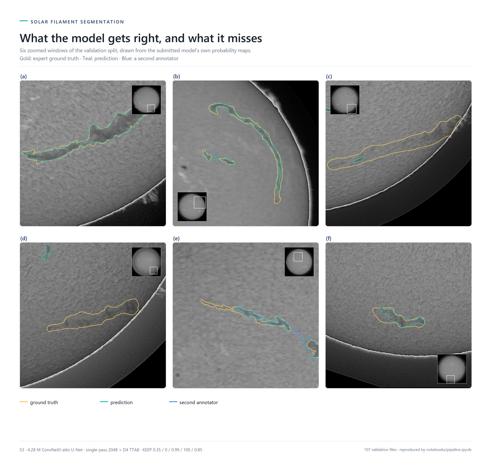
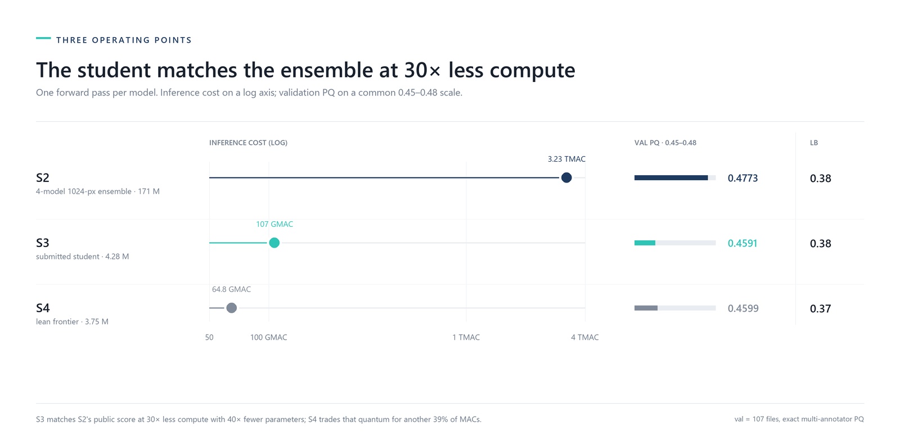

# Efficient Solar Filament Segmentation — submission repository

**4.28 M-parameter ConvNeXt-atto U-Net · val PQ 0.4591 on 107 files · public LB 0.38**

Submitted to the [Solar Filament Segmentation Challenge 2026](https://www.kaggle.com/competitions/filament-segmentation-2026)
(MAGFiLO / GONG H-α, IEEE BigData Cup). It reaches the same leaderboard score as a 171 M
four-model ensemble with **40× fewer parameters** and **~30× less compute** per image.



*Gold: expert ground truth · Teal: prediction · Blue: a second annotator. Six windows of the
107-file validation split, drawn from the submitted model's own probability maps. (a,b) the
prediction follows thin barbs and a large curved body; (c,d) filaments it misses; (e,f) cases
where two annotators disagree and the prediction follows one. Each full-disk inset locates the crop.*

**[4-page technical report](report/main.pdf)** ·
**[Pipeline notebook](notebooks/pipeline.ipynb)** ·
**[Compliance checklist](docs/COMPLIANCE.md)** ·
**[Where every number comes from](docs/RESULTS.md)**

## Verify it yourself

```bash
pip install -r requirements.txt
# competition data under data/MAGFiLO_1.0_Kaggle_2026/ (see data/README.md),
# or point MAGFILO_DATA_DIR at it
jupyter nbconvert --to notebook --execute --inplace notebooks/pipeline.ipynb
```

Expected output, in order: the file split (600 train / 107 validation), the model (4.28 M),
the submission CSV, the verifier, and the exact validation score —

```
rows=1280  images=177
13/13 checks pass
val PQ 0.4591 | SQ 0.6891 | RQ 0.6662 | TP 933 FP 474 FN 461
```

The notebook runs the whole pipeline — split, preprocessing, model, **optional training**,
inference, KEEP post-processing, submission and evaluation — in about two minutes on one GPU.
Set `TRAIN = True` in its first cell to train instead of loading the shipped weights.

## Results



*S2, S3 and S4 at one forward pass per model. Validation PQ on a common 0.45–0.48 scale;
inference cost on a log axis.*

| System | Params | MACs / image | Val PQ (107 files) | Public LB |
|---|---|---|---|---|
| S2 accuracy reference (4×1024 ensemble) | 171.0 M | 3.23 TMAC | 0.4773 | 0.38 |
| **S3 submitted student** | **4.28 M** | **107 GMAC** | **0.4591** | **0.38** |
| S4 lean frontier (64-wide decoder) | 3.75 M | 64.8 GMAC | 0.4599 | 0.37 |

Under the official IoU>0.5 matching the submitted system has **zero** one-to-many and
many-to-one relations; at IoU>0 only 2.4% of ground-truth instances and 5.1% of predictions
overlap more than one partner. The remaining error is under-detection rather than
fragmentation: 63% of false negatives are filaments the model never fires on.

## What is in the repository

| Path | Contents |
|---|---|
| `notebooks/pipeline.ipynb` | the whole pipeline, executed, training optional |
| `report/main.pdf` | 4-page technical report (LaTeX source and figures alongside) |
| `weights/` | the submitted S3 weight (16.4 MiB) and the lean S4 weight (14.4 MiB) |
| `submissions/` | the submitted CSV, the lean and accuracy reference CSVs |
| `predict.py`, `preprocessing.py` | single-pass + TTA inference; disk gate and KEEP primitives |
| `model_v2.py`, `presets.py` | ConvNeXt U-Net; one registry shared by evaluation and submission |
| `eval_pq_v2.py` | the exact multi-annotator Panoptic Quality used in the report |
| `train_v2.py` | training and fine-tuning entry point (the notebook drives it) |
| `tools/verify_submission.py` | 13-check submission CSV verifier |
| `docs/COMPLIANCE.md` | each competition requirement mapped to the file that satisfies it |
| `docs/RESULTS.md` | every reported number and the command that reproduces it |

## Setup

Python 3.11, pinned in `requirements.txt`:

```powershell
pip install -r requirements.txt
```

Download the competition data from Kaggle and place it under
`data/MAGFiLO_1.0_Kaggle_2026/` (see `data/README.md`). If it lives elsewhere:

```powershell
$env:MAGFILO_DATA_DIR = "D:\data\MAGFiLO_1.0_Kaggle_2026"
```

## Reproduce the submitted predictions without retraining

The notebook does this end to end. The equivalent CLI:

```powershell
python submit_keep.py --preset randann_student_swa --path full --tta 8 `
  --t_lo 0.35 --close 0 --t_hi 0.99 --min_area 100 --min_meanp 0.85 `
  --model_dir weights --half --out submissions/regenerated_submission_keep_s3_light.csv
python tools/verify_submission.py submissions/regenerated_submission_keep_s3_light.csv
```

Reference CSV `submissions/submission_keep_s3_light.csv`: 1,279 rows over 177/180 images
(three empty images are legitimate), SHA-256
`9ADF36A4E28AE44368F59E644F26FA105E7456ED7D8F5ED07ABF09ADC92F8217`, 13/13 checks passing.

Re-inference from the shipped weight reproduces **1,277 of those 1,279 rows byte-for-byte**
and the reported validation PQ (0.4591) exactly, in about a minute on one GPU. The difference
is one image: two contours shift by one pixel and a third boundary component passes the area
test, so the regenerated file has 1,280 rows and a different hash by construction. The stored
FP16 test cache is not a substitute — it differs from the submitted file on 31 rows across 22
images. Use CUDA with `--half`.

The nested-CV optimum was `min_area=300`; 100 and 300 are indistinguishable on validation
(0.45906 vs 0.45909), and the submitted CSV uses 100.

## Reproduce the lean S4 point

```powershell
python submit_keep.py --preset atto_dec64_randann_swa --path full --tta 8 `
  --t_lo 0.30 --close 0 --t_hi 0.99 --min_area 100 --min_meanp 0.85 `
  --model_dir weights --half --out submissions/regenerated_submission_keep_s4_lean.csv
```

## Training

The submitted student is a 6-epoch fine-tune from the complete-GT dec128 checkpoint:
1024-px crops, batch 4, AdamW lr 3e-5, KD5 (MSE to five teachers, weight 5),
`--mask_mode random_annotator`, SWA over the last 3 epochs, checkpoints selected by
full-image PQ under the deployed KEEP rule. The parent model was trained for 30 epochs at
lr 1e-4 on first-annotator targets. `train_v2.py` is the entry point; the notebook runs a
reduced version of it when `TRAIN = True`. The five teacher probability maps are not shipped
(they are larger than the model), so that section runs stage 1 only and says so.

## Evaluation

`eval_pq_v2.py` implements the exact competition metric: multi-annotator per-image ground
truth, all-pairs IoU>0.5 matching. `keep_sweep.py` runs nested 5-fold CV and paired
file-level bootstrap for the rule and ensemble choices quoted in the report.

## Data and code policy

Only the H-α competition images are used at inference: the solar-disk gate is computed from
each test image itself, and no external ground-truth metadata, test labels or test-time
adaptation is used. The accuracy reference S2 is reported for comparison; only the submitted
S3 and lean S4 weights are shipped. Per-requirement detail:
[`docs/COMPLIANCE.md`](docs/COMPLIANCE.md).

## Licence

- **Code**: MIT — see `LICENSE`.
- **Weights**: fine-tuned from timm's ImageNet-pretrained `convnext_atto` backbone
  (Apache-2.0) and released under the same terms; the fine-tuned parameters are ours.
- **Data**: not redistributed; download from the competition page (see `data/README.md`).
